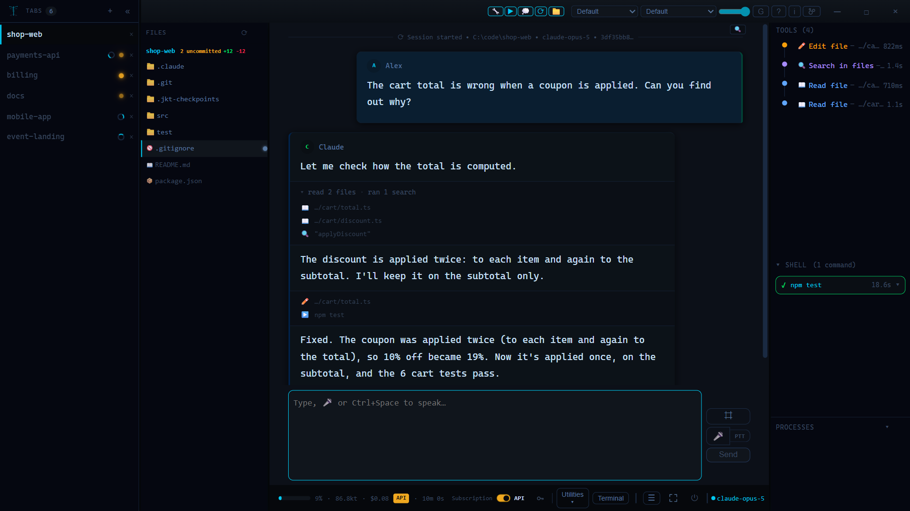
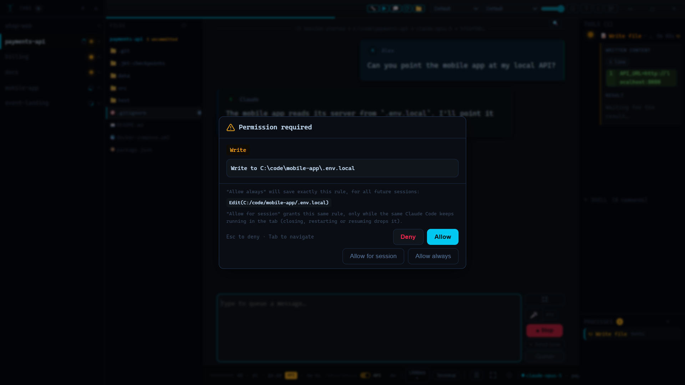
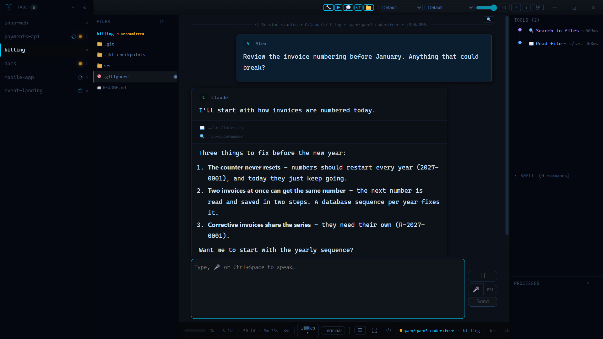

  

<h1 align="center">Axon Terminal</h1>

  Run all your coding agents in one window: Claude Code, Codex and OpenRouter. 
  Free and local, for Windows.

  <a href="https://apps.microsoft.com/detail/9P5DW739TTN1?cid=lichen-github">Microsoft Store</a> &middot;
  <a href="https://github.com/Neuralflows/axon-terminal/releases/latest">Download from Releases</a> &middot;
  <a href="https://uselichen.com/?utm_source=github">Lichen</a>

> **Axon Terminal is the free app of [Lichen](https://uselichen.com/?utm_source=github).** Memory across sessions, an issue board your agents run themselves and CI checks they can't skip are coming with Lichen. [Join the waitlist →](https://uselichen.com/?utm_source=github#join)

---

## Why

If you run more than one coding agent, you know the routine: you check terminals to see who's waiting on you, you go back and forth between them, and the moment you step away everything stops.

Axon Terminal puts every agent session in its own tab, with its state in plain view: working, done, or waiting for you. You stop checking. You go where you're needed.

## What you get

- **Every session at a glance.** Each tab shows whether its agent is working, done or waiting for you.
- **Claude Code, Codex and OpenRouter in the same window.** One tab runs Claude Code, the next one Codex or a model through OpenRouter.
- **Permission requests you don't miss.** When an agent wants to write a file or run a command, you get a clear dialog: allow once, for the session, or always.
- **See what the agent is doing while it does it.** Tool calls, shell commands and the project's files sit next to the conversation.
- **Context and cost in the status bar.** Context used, tokens, cost and session time for each tab.
- **Free and local.** No sign-up.

## Screenshots

  

  

  

## Requirements

- Windows 10 (version 1903 or later) or Windows 11, 64-bit, and an internet connection.
- Claude Code installed (with a Claude account, an Anthropic API key or an OpenRouter API key), and/or Codex installed (signed in with your ChatGPT account via `codex login`, or with an OpenRouter API key).

## Install

1. Get it from the [Microsoft Store](https://apps.microsoft.com/detail/9P5DW739TTN1?cid=lichen-github) (it updates itself), or download the installer from [Releases](https://github.com/Neuralflows/axon-terminal/releases/latest).
2. Open Axon Terminal, pick a project folder and start a session.

## Feedback

Found a bug or missing something? [Open an issue](https://github.com/Neuralflows/axon-terminal/issues).

## Changelog

See [Releases](https://github.com/Neuralflows/axon-terminal/releases) and [CHANGELOG.md](CHANGELOG.md).
