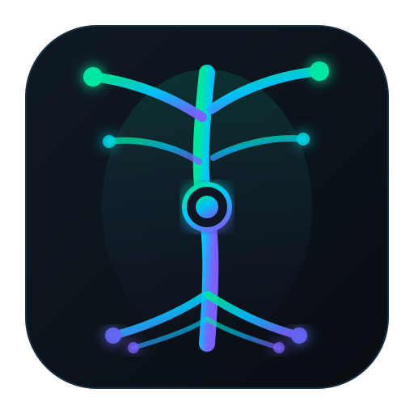
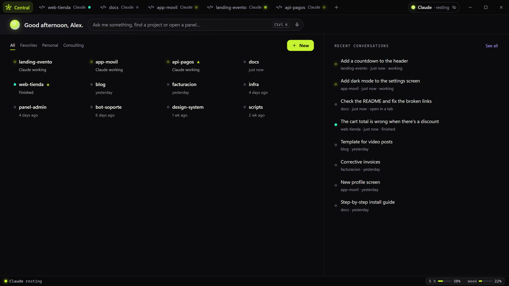
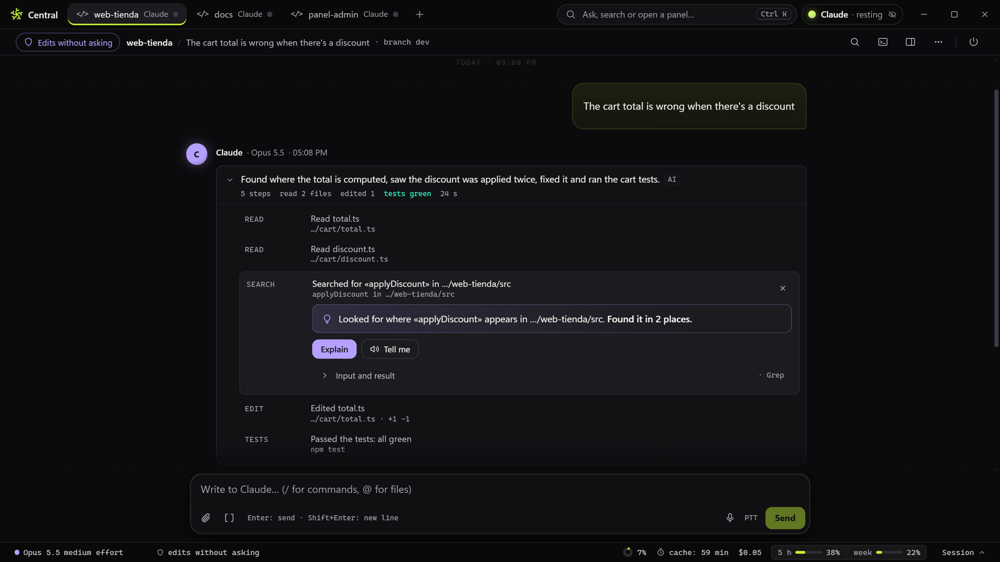
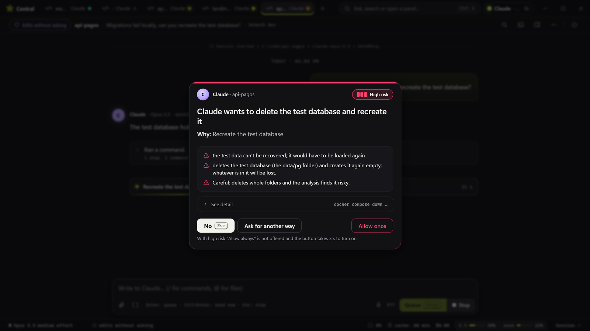
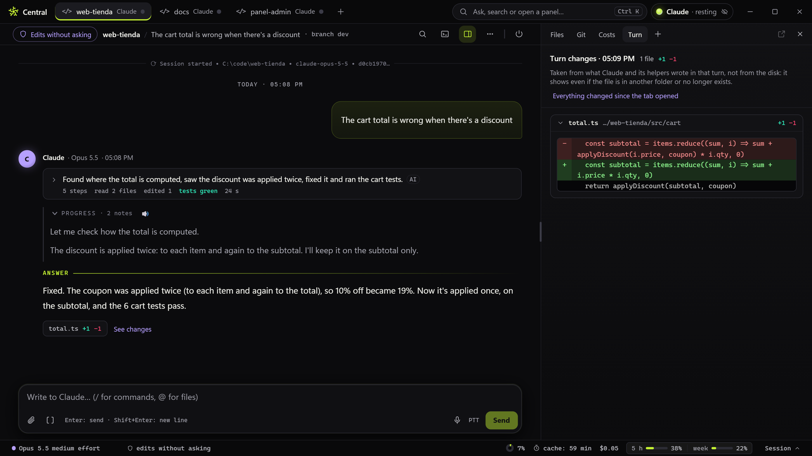
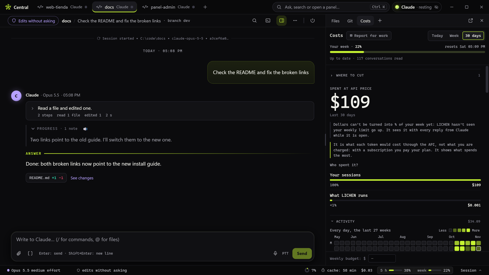

  

<h1 align="center">Lichen</h1>

  Your coding agents, managed and fast. 
  Built for speed first: in our lab test, a 300-turn conversation updates in about 70 ms per tool event, down from 1.8 s. Run your Claude Code and Codex agents as a team, see at a glance what each one is doing and what it costs, and talk to them by voice. Free for Windows.

  <a href="https://apps.microsoft.com/detail/9P5DW739TTN1?cid=lichen-github">Microsoft Store</a> &middot;
  <a href="https://github.com/Neuralflows/axon-terminal/releases/latest">Download from Releases</a> &middot;
  <a href="https://uselichen.com/?utm_source=github">uselichen.com</a>

---

## Why

With several coding agents running, the hard part isn't reading their code: it's knowing which one is stuck, how much context it has left, what it costs and what it already tried last week. Run three of them in terminals and you also become the messenger between them.

Lichen is a desktop app for directing coding agents, built for speed first. Everything in one place.

> "Since I started using Lichen I don't open a terminal, VS Code or File Explorer anymore. My agents do all of it inside Lichen, and it stays open all day."
> — Manu, who builds Lichen

## What you get

- **Fast in long conversations.** In our lab test, a 300-turn conversation went from about 1.8 s to about 70 ms per tool event. Find past conversations by name, project or the start of their first message, and pick them up again.
- **A team, not a pile of tabs.** Agents can message each other and open new sessions to hand work over, and Lichen warns you when a conversation is getting expensive to keep going. Your assistant keeps track of all of them while you talk to one.
- **Every agent at a glance.** Working, done or waiting for you, with its context, its cost, and how much of your Claude plan's 5-hour and weekly limits is gone. Lichen warns you before a long conversation's prompt cache runs out.
- **Talk to them.** Voice in and out, and an avatar for your assistant.
- **The details, when you want them.** Every tool call, process, hook and MCP server, the git diff and the project files, next to the conversation. Agents can propose a deletion instead of doing it: you approve it with a click and a confirmation, and it goes to a trash you can restore it from.
- **Remote machines too.** Run Claude Code sessions on a server over SSH, with your SSH key, in the same window. The file, git, diff and terminal panels only work in local sessions for now.
- **Permission requests you can actually read.** Allow once, for the session or always, with a plain explanation and the exact command one click away.
- **Free and local.** No sign-up.
- **Private by default.** No account needed. Without one, the only requests to Lichen's servers are the update check and the news; usage telemetry and crash reports stay off unless you turn them on (nothing is preselected). Details on the [privacy page](https://uselichen.com/privacy).

**With a Lichen account (waitlist):** memory your agents share across sessions, an issue tracker they run themselves over MCP and CI checks they can't skip. [Join the waitlist →](https://uselichen.com/?utm_source=github#join)

## Screenshots

  

  

  

  

  

## Requirements

- Windows 10 (1903 or later) or Windows 11, 64-bit.
- Claude Code (Claude account, Anthropic API key or OpenRouter key) and/or Codex (ChatGPT sign-in or OpenRouter key).

## Install

1. Get it from the [Microsoft Store](https://apps.microsoft.com/detail/9P5DW739TTN1?cid=lichen-github) (it updates itself) or download the installer from [Releases](https://github.com/Neuralflows/axon-terminal/releases/latest).
2. Open the app, pick a project folder and start a session.

## Feedback

Found a bug or missing something? [Open an issue](https://github.com/Neuralflows/axon-terminal/issues).

## Changelog

See [Releases](https://github.com/Neuralflows/axon-terminal/releases) and [CHANGELOG.md](CHANGELOG.md).

## License

Free for personal and commercial use. Lichen isn't open source: the binaries and the changelog are public here. Full text: [LICENSE](LICENSE) and [uselichen.com/license](https://uselichen.com/license).
