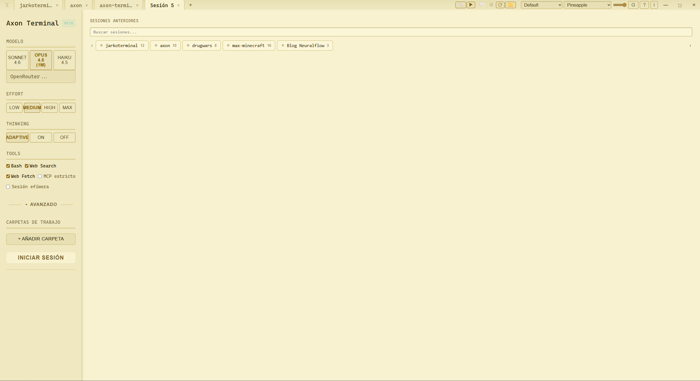
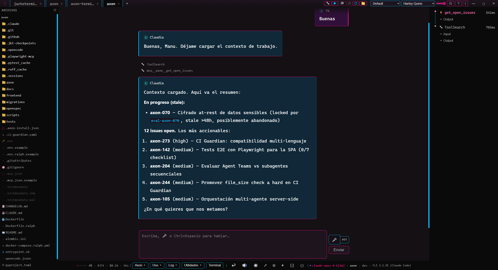
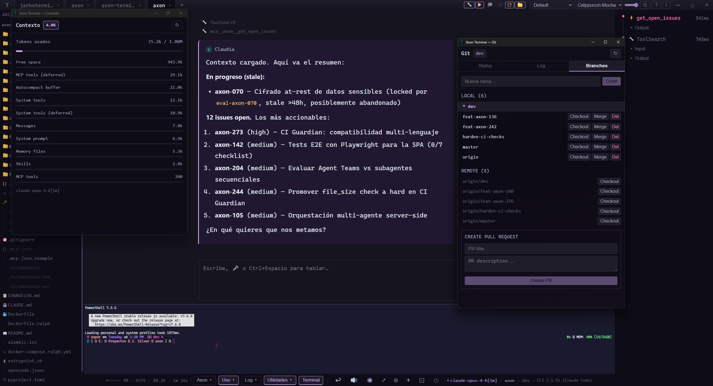

   

<h1 align="center">Axon Terminal</h1>

  Deja de perder contexto haciendo scroll en la terminal. 
  Ve todo lo que hace Claude de un vistazo, controla el coste y trabaja mas rapido.

  <a href="https://terminal.neuralflow.es">Web</a> &middot;
  <a href="https://github.com/Neuralflows/axon-terminal/releases">Descargar</a> &middot;
  <a href="#por-que">Por que</a> &middot;
  <a href="#changelog">Changelog</a>

---

## Por que

Claude Code es potente, pero en una terminal convencional pierdes contexto constantemente: scroll infinito, output mezclado, cero visibilidad de lo que esta pasando, y ninguna idea de cuanto estas gastando.

Axon Terminal elimina esas fricciones. Es un wrapper de Claude Code que separa cada flujo de informacion en su propio panel para que siempre sepas que esta haciendo Claude con tu codigo.

## Que resuelve

**Ve todo lo que pasa, sin scroll** — En la CLI pierdes contexto haciendo scroll. Aqui cada cosa tiene su sitio: conversacion, tools, shell, thinking, diff, tareas — todo visible a la vez.

**Controla cuanto gastas** — Tokens, coste acumulado, modelo, contexto consumido y duracion. Todo en la StatusLine, siempre visible. Sin sorpresas en la factura.

**Revisa cambios antes de que sea tarde** — Diff side-by-side en tiempo real. Ve exactamente que esta tocando Claude en tu codigo mientras lo hace, no despues.

**No pierdas la pista de lo que toco** — Claude edita 15 archivos y no sabes cuales. Arbol de archivos con estado git en vivo, +N/-N por archivo y heatmap de cambios.

**Deja de saltar entre ventanas** — Cada vez que necesitas ejecutar un comando, sales de Claude, abres otra terminal, vuelves. PowerShell o CMD integrado — Ctrl+` y listo.

**Sesiones que no se pierden** — Cierra la app, vuelve manana. Si algo falla, reconecta automaticamente. Tus sesiones se guardan y reanudan con todo el contexto intacto.

**Deja de abrir ventanas para cada proyecto** — Multiples sesiones independientes en la misma app. Extrae cualquier panel como ventana flotante si necesitas tenerlo siempre a la vista.

**Concentrate sin ruido** — Demasiados paneles, demasiada informacion. Zen mode oculta todo salvo la conversacion para que solo existas tu y Claude.

**Todo el ecosistema, sin rebuscar** — MCP servers, skills, agentes, permisos — en Claude Code los configuras a ciegas. Aqui estan todos en paneles dedicados donde puedes verlos y gestionarlos.

**Sin miedo a romper nada** — Claude edita directo en tu carpeta por defecto. Si prefieres, activa worktree y revisa los cambios antes de aplicarlos.

**Las manos en el codigo, no en el prompt** — Describe lo que necesitas por voz y sigue trabajando. Push-to-talk configurable y wake word opcional.

**Tu entorno, tus reglas** — 13 temas, fuentes configurables, transparencia, y layout que se adapta a ti.

## Screenshots

  

  

  

## Requisitos

- **Windows 10/11** (64-bit)
- **Claude Code CLI** instalado y autenticado (`claude` disponible en PATH)
- Suscripcion activa a Claude (Max, Pro o Team)

## Instalacion

1. Descarga el instalador desde [Releases](https://github.com/Neuralflows/axon-terminal/releases) o desde [terminal.neuralflow.es](https://terminal.neuralflow.es)
2. Ejecuta el `.exe` — se instala en segundos
3. Abre Axon Terminal, selecciona una carpeta de proyecto y empieza

## Changelog

### v0.99.0 (2026-04-07)

- Terminal integrada con PowerShell/CMD real — Ctrl+`, el proceso sobrevive al abrir/cerrar
- Selector de shell: PowerShell Core, PowerShell o CMD sin reiniciar
- Reconexion automatica si el terminal muere
- Zen mode: oculta toda la UI salvo la conversacion
- Arbol de archivos mejorado: +N -N por archivo, heatmap de cambios, archivos ignorados atenuados
- Deteccion de version CLI: te avisa si Claude Code se actualizo entre sesiones
- 183 tests automatizados + CI Guardian en cada commit
- Los procesos ya no se acumulan al cerrar — shutdown graceful + limpieza de huerfanos
- OpenRouter con retry automatico para rate limits

### v0.9.0 (2026-03-30)

- Los checkpoints ya no ensucian tu historial git — snapshots comprimidos fuera de git
- Iconos en el arbol de archivos segun tipo
- CHANGELOG reconstruido desde el dia uno

### v0.8.0 (2026-03-30)

- Pop-outs que siguen el tab activo sin desconectarse
- Pestanas arrastrables, layout configurable, transparencia de ventana
- Telemetria arreglada, permisos simplificados, limpieza de codigo muerto

### v0.7.0 (2026-03-28)

- Pantalla de inicio rediseñada
- Wake word para dictado
- Nombres personalizables en el chat
- Opus 4.6 (1M) como opcion por defecto

### v0.6.0 (2026-03-27)

- Selector de effort level (Low/Medium/High/Max)
- Comandos mid-session: /model, /effort, /permissions, /editor
- Editor externo configurable
- Undo que preserva la conversacion

### v0.5.1 (2026-03-26)

- Checkpoints — vuelve atras si algo sale mal
- Reconexion automatica tras crash
- Historial agrupado por proyecto
- Exportar a Markdown

### v0.5.0 (2026-03-24)

- Multi-tab, busqueda en conversacion, atajos de teclado
- Notificaciones de escritorio, dictado por voz configurable
- Diff redimensionable

### v0.4.0 (2026-03-24)

- StatusLine con modelo, proyecto, rama, tokens, coste y duracion
- F11 fullscreen, PermissionDialog

### v0.3.0 (2026-03-23)

- Worktree opcional, historial de sesiones con resume
- Sistema de ayuda, temas centralizados, slash commands custom

### v0.2.0 (2026-03-21)

- Sistema de temas, panel toggles, sesiones pendientes, update checker

### v0.1.0 (2026-03-15)

- Release inicial

## Reportar bugs / Pedir features

Usa el [issue tracker](https://github.com/Neuralflows/axon-terminal/issues) de este repositorio.

## Licencia

Axon Terminal es software propietario. Consulta los [terminos de uso](https://terminal.neuralflow.es/terms) y la [politica de privacidad](https://terminal.neuralflow.es/privacy).

---

  Hecho por <a href="https://neuralflow.es">Neuralflow</a>

